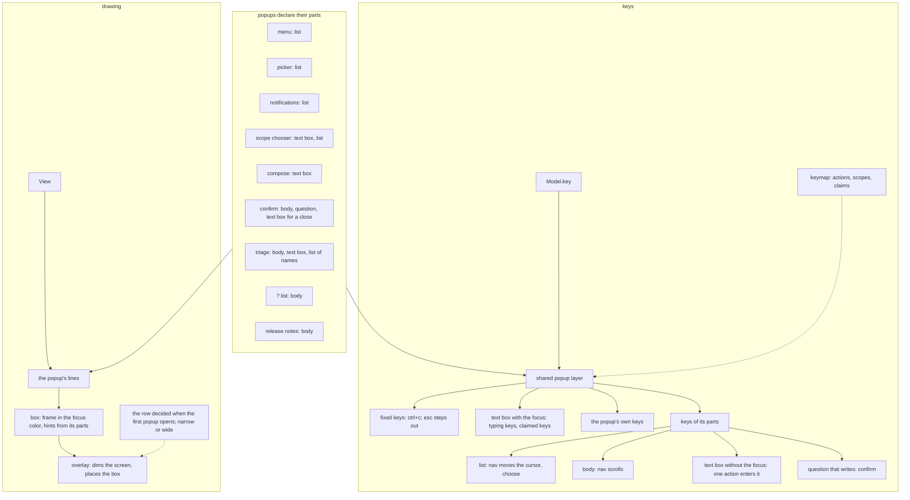

# Popups

What a popup is in `internal/tui`, which popups there are, what each holds, and how they are drawn and read keys. The rules are in [ADR-121](../adr/121-no-popup-is-drawn-over-another.md) (one popup at a time), [ADR-079](../adr/079-what-takes-the-keys-says-so-by-its-frame.md) (the frame tells what takes the keys), [ADR-125](../adr/125-a-popup-reads-the-keys-of-what-it-holds.md) (keys come from what a popup holds; where it stands) and [ADR-126](../adr/126-the-key-line-under-a-popup-tells-its-writes.md) (the key line under a popup) and [ADR-127](../adr/127-a-popup-opens-where-the-eye-is.md) (the row a popup opens on).

## What a popup is

A popup is a box drawn over the screen that takes every key while it is open. It is drawn in three steps, each knowing nothing of the next:

1. The popup builds its lines (`renderMenu`, `renderBulk`, ...).
2. `box` in [internal/tui](../../internal/tui) puts them in a frame, in the focus color.
3. `overlay` in [view.go](../../internal/tui/view.go) dims the whole screen to one faint color and places the box over it, from the row popups are drawn from (`popupTop`) and centered across.

`overlay` is how a popup is drawn, not a popup: it takes any lines. What is drawn over the screen without dimming it is not a popup and does not go through `overlay`: the log viewer, placed beside the list, and a notification's toast.

The claude pane and the log viewer take the keys too, but are not popups (ADR-079).

## The popups

| Popup | Field of `Model` | Opened by (action) | Parts it holds | Width |
|---|---|---|---|---|
| menu | `menu` | `menu` | list | narrow |
| confirm | `bulk` | the writing actions, `post` of compose, `triage_apply` | body, question; a text box for a close | wide |
| compose (comment, review) | `compose` | `comment`, `review` | text box | wide |
| picker | `picker` | `select_rule` | list | wide |
| scope chooser | `chooser` | `choose_scope` | text box, list | narrow |
| notifications | `notesAt` | `events` | list | wide |
| triage | `triage` (`open`) | `triage` | body, text box; a list of names while `#` or `@` is typed; a search of the questions | wide |
| `?` list | `help` | `help` | body | narrow |
| release notes | `relBox` (with `help`) | `release_notes` | body | wide |

Which one is open is read in a fixed order in `Model.key` and `View`: confirm, notifications, picker, chooser, menu, triage, then `?` and its release notes. Compose is read after them, since the confirm takes its place while open (ADR-121).

## Parts and their keys

Keys are written as actions; their default keys are in [internal/tui/keymap](../../internal/tui/keymap) and on the [keys reference](../reference/keys.md).

| Part | What the shared layer reads |
|---|---|
| every popup | `esc` steps out of the innermost level the popup declares (suggestions or a search over a text box, a request on its way, the text box, the popup); `esc` alone closes it; neither the action that opened it nor `quit` does |
| list | nav's `up`, `down`, `top`, `bottom`, `page_up`, `page_down` move the cursor; `choose` |
| body | the same nav actions scroll |
| text box | with the focus, every key that types a character and every key no step before it takes (its own editing keys); the popup's other parts read only keys that type nothing and the nav keys it does not edit with. Without the focus, one action enters it |
| question that writes | `confirm`, never while a text box has the focus (ADR-066) |

The hints in a popup's frame are made from its parts and its own keys. A popup marks the keys that write or lead on to a write (the question, `post`, `triage_apply`); only those, and what `esc` does, are also shown on the key line while it is open (ADR-125, ADR-126).

A popup's own keys are declared for the state it is in, and are read after the keys that type a character (which go to a focused text box) and before its other parts: `next_kind`, `post` and `editor` in compose; `include_failing`, `wait_for_checks` and `delete_branch` in the confirm; `toggle_rule`, `add_to_selection` and `filter_by_rule` in the picker; `triage_apply` in the triage; `release_notes` and `fold` in the `?` list; each item's action in the menu.

### How it is built

Every popup reads its keys through the shared layer in [popupkeys.go](../../internal/tui/popupkeys.go), in the order of ADR-125: each declares its parts and its own keys for the state it is in (`menuSpec`, `pickSpec`, `notesSpec`, `chooserSpec`, `helpSpec`, `releaseSpec`, `bulkSpec`, `composeSpec`, `triageSpec`), built again for each key and each draw, so a declaration changes nothing. `openPopup` in [view.go](../../internal/tui/view.go) finds the one open. Their mouse input goes through the same layer, but for the triage while a question is typed or a request is on its way.

- `history_next` and `history_prev` claim the keys of `down` and `up` ([keymap](../../internal/tui/keymap)): a text box tries them first, and moves its cursor when there is nothing to recall.
- The scope chooser's one-line text box keeps `top`, `bottom` and the page keys for editing, and gives `up` and `down` to its list.
- A comment or a review is thrown away by the second `esc`, the first leaving its text box.
- The foot of each popup, and the key line under it, are made from its declaration (`popupHints`), each key with the words the popup gives it.
- Two levels over the triage's text box read their keys before the layer: the list of names offered while `#` or `@` is typed (`askMenuKey`) and the search of the questions (`searchKey`), whose cursors are `askbox`'s own. They move on `up` and `down` only, and their foot is written in `renderTriage`.

## Placement

A popup is placed when it opens with none open (`placePopup` in [popup.go](../../internal/tui/popup.go), called from `render` in [view.go](../../internal/tui/view.go)): a quarter down the screen, or higher for one too tall to fit below that, as far from the top of the list as from the status line, and never above `popupTopMost` (ADR-127). The row is kept in `Model.popTop` while popups are open, so one taking the place of another opens there, and is decided again on a resize or when a popup opens after all have closed. From that row a popup grows down to `popupHeight` and scrolls its body past it, keeping its foot in sight.

Its width is `popupWidth`, narrow or wide from two constants there; a popup that takes the place of another (the confirm popup of a review) is as wide as the one it replaces.

## Diagrams

