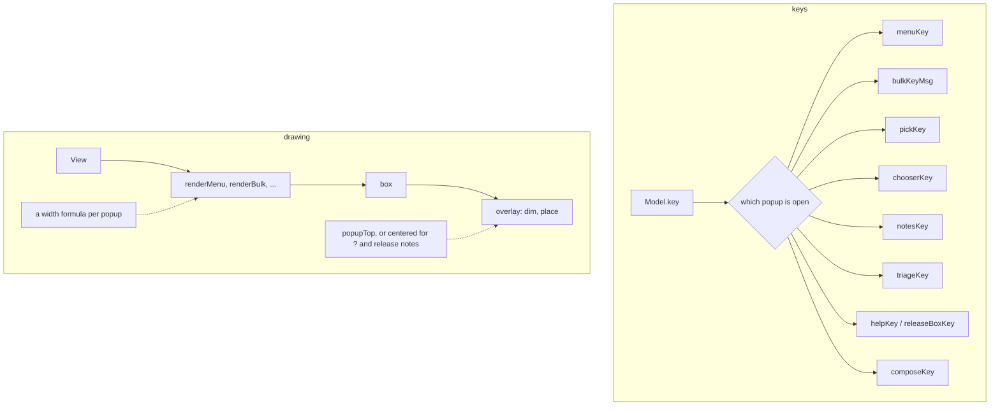
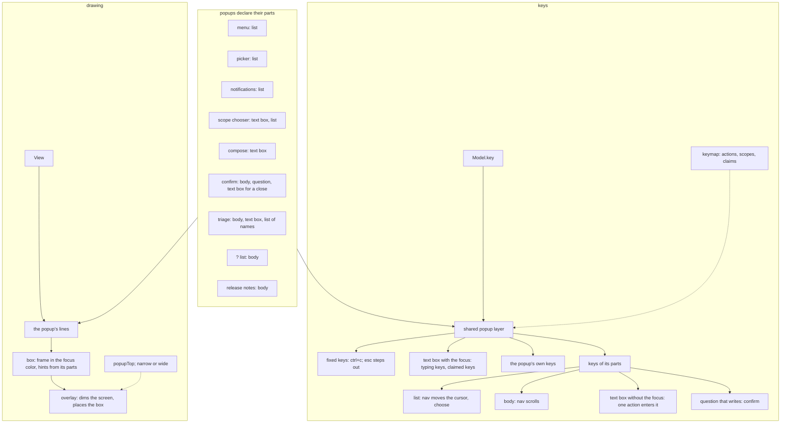

# Popups

What a popup is in `internal/tui`, which popups there are, what each holds, and how they are drawn and read keys. The rules are in [ADR-121](../adr/121-no-popup-is-drawn-over-another.md) (one popup at a time), [ADR-079](../adr/079-what-takes-the-keys-says-so-by-its-frame.md) (the frame tells what takes the keys) and [ADR-125](../adr/125-a-popup-reads-the-keys-of-what-it-holds.md) (keys come from what a popup holds; where it stands).

ADR-125 is not built yet. "Today" below is the code as it is; "Target" is the shape ADR-125 sets. When the code follows it, the "Today" parts go.

## What a popup is

A popup is a box drawn over the screen that takes every key while it is open. It is drawn in three steps, each knowing nothing of the next:

1. The popup builds its lines (`renderMenu`, `renderBulk`, ...).
2. `box` in [internal/tui](../../internal/tui) puts them in a frame, in the focus color.
3. `overlay` in [view.go](../../internal/tui/view.go) dims the whole screen to one faint color and places the box over it, centered across.

`overlay` is how a popup is drawn, not a popup: it takes any lines. What is drawn over the screen without dimming it is not a popup and does not go through `overlay`: the log viewer, placed beside the list, and a notification's toast.

The claude pane and the log viewer take the keys too, but are not popups (ADR-079).

## The popups

| Popup | Field of `Model` | Opened by (action) | Parts it holds | Width (target) |
|---|---|---|---|---|
| menu | `menu` | `menu` | list | narrow |
| confirm | `bulk` | the writing actions, `post` of compose, `triage_apply` | body, question; a text box for a close | wide |
| compose (comment, review) | `compose` | `comment`, `review` | text box | wide |
| picker | `picker` | `select_rule` | list | wide |
| scope chooser | `chooser` | `choose_scope` | text box, list | narrow |
| notifications | `notesAt` | `events` | list | wide |
| triage | `triage` (`open`) | `triage` | body, text box; a list of names while `#` or `@` is typed; a search of the questions | wide |
| `?` list | `help` | `help` | body | narrow |
| release notes | `relBox` (with `help`) | `release_notes` | body | wide |

Which one is open is read in a fixed order in `Model.key` and `View`: confirm, notifications, picker, chooser, menu, triage, then `?` and its release notes. Compose is read after them, since the confirm takes its place while open (ADR-121).

## Parts and their keys

Keys are written as actions; their default keys are in [internal/tui/keymap](../../internal/tui/keymap) and on the [keys reference](../reference/keys.md).

| Part | Target: what the shared layer reads |
|---|---|
| every popup | `esc` steps out one level; the action that opened it closes it, unless a part reads that key first; `quit` is not read |
| list | nav's `up`, `down`, `top`, `bottom`, `page_up`, `page_down` move the cursor; `choose` |
| body | the same nav actions scroll |
| text box | with the focus, every key that types a character, and the keys it claims (cursor, history); without it, one action enters it, and `esc` from it goes back to the popup |
| question that writes | `confirm` |

A popup's own keys are read after the text box and before its other parts: `next_kind`, `post` and `editor` in compose; `include_failing`, `wait_for_checks` and `delete_branch` in the confirm; `toggle_rule`, `add_to_selection` and `filter_by_rule` in the picker; `triage_apply` in the triage; `release_notes` and `fold` in the `?` list; each item's action in the menu.

### Today

Each popup reads its keys in its own function (`menuKey`, `bulkKeyMsg`, `composeKey`, `pickKey`, `chooserKey`, `notesKey`, `triageKey`, `helpKey`, `releaseBoxKey`), so the parts above take different keys from popup to popup:

- Lists move on `up` and `down` everywhere; on `top` and `bottom` only in the menu; on `history_next` and `history_prev` only in the scope chooser and the triage's list of names. Bodies scroll by page only in the `?` list and the release notes.
- The opening action closes the picker, the notifications, the `?` list and the release notes, and is ignored or typed in the others. `quit` closes the notifications, the `?` list and the release notes.
- `esc` throws a comment or a review away at once.
- Entering a text box is `write_comment` in the confirm of a close and `triage_more` in the triage, which happen to share a default key.
- The foot of each popup is written by hand, apart from the key line the keymap makes.

## Placement

Target: every popup is drawn from `popupTop` in [popup.go](../../internal/tui/popup.go), grows down to `popupHeight` and scrolls its body past it, keeping its foot in sight. It is narrow or wide, from two constants.

Today: seven popups are drawn from `popupTop`. The `?` list and the release notes are centered from top to bottom, in `renderHelp` and `renderReleaseNotes`. Each popup computes its width with its own formula (`composeWidth`, `triageWidth`, `helpWidth`, `releaseNotesWidth`, and inline in `renderMenu`, `renderPick`, `renderChooser`, `renderNotes`, `renderBulk`).

## Diagrams

### Today

### Target

